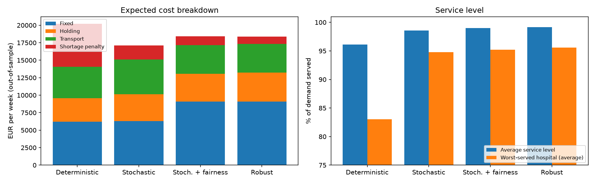
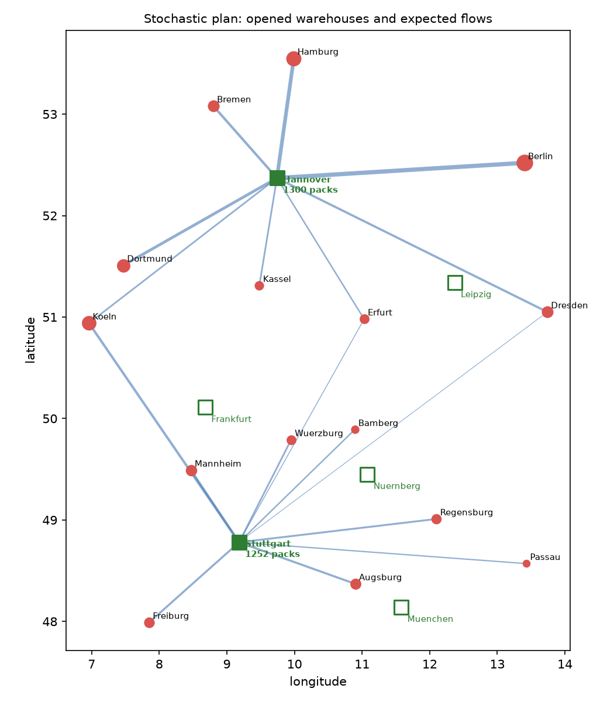

# Resilient Medicine Supply Network – Stochastic & Robust Mixed-Integer Optimization

Which warehouses should a medicine distributor operate, and how much stock should it pre-position
in each, when hospital demand is uncertain and warehouses can be disrupted?

This project answers that question with **mixed-integer linear programming (MILP)**, **two-stage stochastic optimization** and
**robust (min-max) optimization** in Python, and evaluates the plans out of sample.
It shows how planning for uncertainty instead of the average case cuts expected cost by
about 15% and reduces the share of weeks with medicine shortages from 47% to 6%.



## Problem

- **6 candidate warehouses** (Nürnberg, Frankfurt, München, Leipzig, Stuttgart, Hannover), each with a weekly fixed operating cost and a capacity.
- **15 hospitals** across Germany with uncertain weekly demand for one critical medicine.
- Transport cost is proportional to great-circle distance.
- Unmet demand is penalised (60 EUR per pack), because a shortage of medicine is far worse than an extra delivery.
- **Uncertainty:** demand varies (lognormal, coefficient of variation 25%), and in 15% of weeks a random warehouse is disrupted (only 20% of its stock can be shipped, e.g. cold-chain failure or blocked roads).

## Mathematical model

First-stage decisions (taken now): open warehouse `y_w ∈ {0,1}`, pre-positioned stock `q_w ≥ 0`.
Second-stage decisions (per scenario `k`, after demand and disruptions are known): shipments `x_whk ≥ 0`, shortage `s_hk ≥ 0`.

```
min   Σ_w f_w y_w  +  hold · Σ_w q_w  +  Σ_k p_k ( Σ_w Σ_h c_wh x_whk  +  penalty · Σ_h s_hk )

s.t.  q_w ≤ cap_w · y_w                        ∀ w          (stock only at open warehouses)
      Σ_w x_whk + s_hk = d_hk                  ∀ h, k       (demand is served or counted as shortage)
      Σ_h x_whk ≤ a_wk · q_w                   ∀ w, k       (only stock that survives a disruption can ship)
      s_hk ≤ (1 − α) · d_hk                    ∀ h, k       (optional fairness: every hospital gets ≥ α of its demand)
```

**Robust variant (min-max):** instead of the expected second-stage cost, minimise the worst case
over all scenarios with an epigraph variable `t`:

```
min   Σ_w f_w y_w  +  hold · Σ_w q_w  +  t
s.t.  t ≥ Σ_w Σ_h c_wh x_whk + penalty · Σ_h s_hk     ∀ k      (plus all constraints above)
```

With a single scenario at mean demand and no disruptions, the model becomes the classic
deterministic **capacitated facility location problem**.

It is solved with **HiGHS** through `scipy.optimize.milp`. The 60-scenario model has about
6,300 variables and is solved to optimality in a few seconds.

## Experiments

| Plan | How it is built |
|---|---|
| Deterministic | Optimised for mean demand, no disruptions (what a naive planner does) |
| Stochastic | Two-stage stochastic program over 60 sampled scenarios |
| Stochastic + fairness | Same, plus every hospital must receive ≥ 95% of demand in every training scenario |
| Robust (min-max) | Minimises the worst-case cost over the 60 scenarios instead of the expected cost |

Each plan is then **evaluated out of sample on 200 unseen scenarios**: its first-stage decisions
are fixed and the best shipments are re-optimised per scenario.

## Results

Out-of-sample, EUR per week:

| | Deterministic | Stochastic | Stochastic + fairness | Robust (min-max) |
|---|---|---|---|---|
| Open warehouses (stock) | Nürnberg (980), Hannover (1260) | Stuttgart (1252), Hannover (1300) | Leipzig (597), Stuttgart (747), Hannover (1300) | Leipzig (580), Stuttgart (862), Hannover (1300) |
| Expected total cost | 20,222 | **17,094** | 18,436 | 18,357 |
| Worst-week total cost | 76,456 | 61,376 | 57,989 | **52,578** |
| Expected shortage cost | 6,143 | 2,009 | 1,283 | **1,047** |
| Average service level | 96.1% | 98.6% | 99.0% | **99.2%** |
| Worst-served hospital (avg.) | 83.0% | 94.8% | 95.2% | **95.6%** |
| Weeks with any shortage | 46.5% | 6.0% | 6.0% | **5.5%** |

Standard stochastic programming metrics (training scenarios):

| Metric | EUR/week | Meaning |
|---|---|---|
| RP | 15,679 | Expected cost of the stochastic solution |
| EEV | 18,697 | Expected cost of the deterministic plan under uncertainty |
| WS | 14,297 | Cost with perfect foresight (wait-and-see) |
| **VSS = EEV − RP** | **3,017** | Value of the stochastic solution |
| **EVPI = RP − WS** | **1,382** | Value of perfect information (upper bound on what better forecasting is worth) |

### Key insights

1. **Planning for the average is expensive.** The deterministic plan stocks exactly the mean demand,
   so it runs short in almost half of all weeks. The stochastic plan adds a safety buffer and
   picks a different warehouse pair, cutting expected cost by 15% (VSS ≈ 3,000 EUR/week).
2. **The network structure changes, not only the stock levels.** Uncertainty moves the southern hub from
   Nürnberg to Stuttgart, which can serve the south-west (Freiburg, Mannheim, Köln) as backup.
3. **Fairness has a measurable price.** Requiring ≥ 95% service for every hospital opens a third warehouse
   (Leipzig, close to Berlin and Dresden). This costs about 1,340 EUR/week (8%) more, but cuts
   shortage cost by 36% and lifts the worst-served hospital.
4. **Robustness has a price, too.** The min-max robust plan cuts the cost of the worst week by 14% versus the
   stochastic plan (31% versus the deterministic plan) and has the fewest shortages, but its expected cost is
   7% higher. Stochastic optimization suits a risk-neutral planner; robust optimization suits a planner who
   must guarantee supply even in the worst case, as with critical medicines.
5. **Better forecasting is worth at most ~1,400 EUR/week** (EVPI), less than half the gain from simply
   modelling uncertainty correctly (VSS).
6. **Limitation:** even the fair plan has rare scenarios where one hospital is left completely unserved,
   because the fairness rule binds only at the planning stage, not in daily operations. Adding a
   fair allocation rule to the operational model (e.g. maximise the minimum service level) would fix this.



## How to run

```bash
pip install -r requirements.txt
python src/run.py
```

All tables and figures are written to `results/`.

## Project structure

```
src/data.py    network data, distances (haversine), scenario generation
src/model.py   two-stage stochastic and robust MILP (builder class + HiGHS solver via SciPy)
src/run.py     experiments, out-of-sample evaluation, VSS/EVPI, worst-case cost, plots
results/       CSV outputs and figures
```

## Possible extensions

- **Budgeted robust optimization:** replace the scenario set with a Bertsimas–Sim uncertainty set and control conservatism with a budget parameter.
- **CVaR objective:** trade off expected cost against tail risk of shortages.
- **Multi-period model:** replenishment and expiry of medicines over several weeks.
- **Real data:** BfArM drug shortage reports and hospital bed counts for demand estimates.
- **Decomposition:** Benders / L-shaped method for thousands of scenarios.
